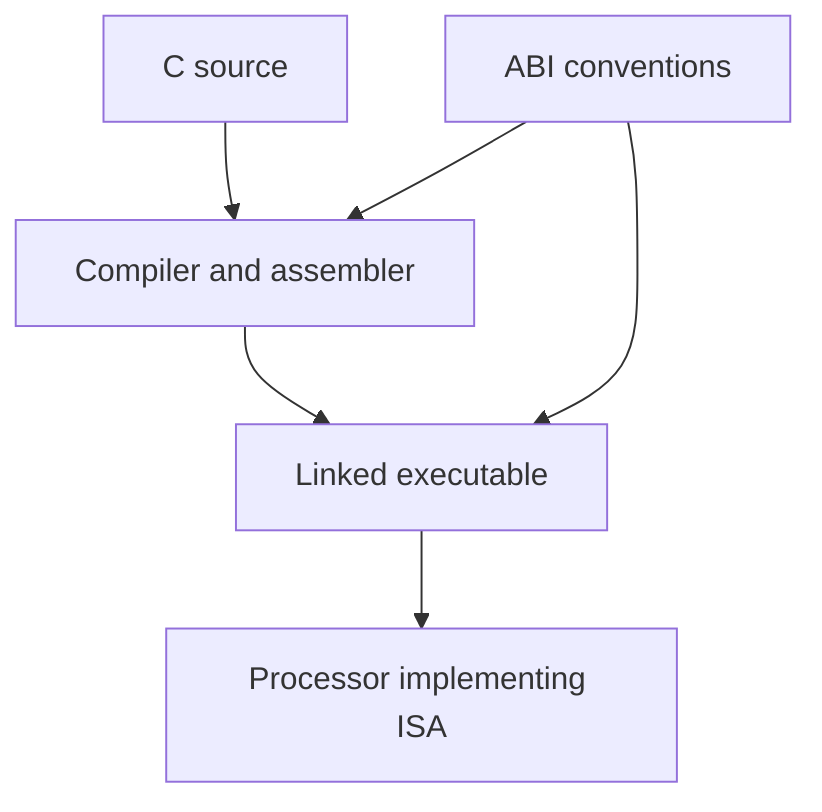

# Application Binary Interface (ABI)

## Overview
The ABI defines binary-level conventions that allow separately compiled functions and libraries to cooperate. Unlike the ISA, which specifies machine instructions and architectural state, the ABI specifies how software uses that state.

| ISA | ABI |
|---|---|
| Instruction encodings and semantics | Calling convention and binary layout |
| Architectural registers | Register roles and preservation |
| Load/store behavior | Stack alignment and data layout |

## Software flow

For RV64, LP64 uses 32-bit int and 64-bit long and pointers; ILP32 uses 32-bit int, long and pointers. The ABI must match the target and linked libraries. The integer calling convention passes initial arguments in a0–a7 and returns ordinary scalar results in a0.

## Learning outcome
The ABI explains why a C function can call an assembly routine without knowing its internal implementation. The CPU executes instructions; software follows the ABI conventions.

## Workshop reference
Topic sequence based on the [Day 2 workshop notes](https://github.com/chinmaya24163/NASSCOM-RISC-V-MYTH/tree/main/day2). Explanations and examples are independently written; no reference screenshots or results are reproduced.
