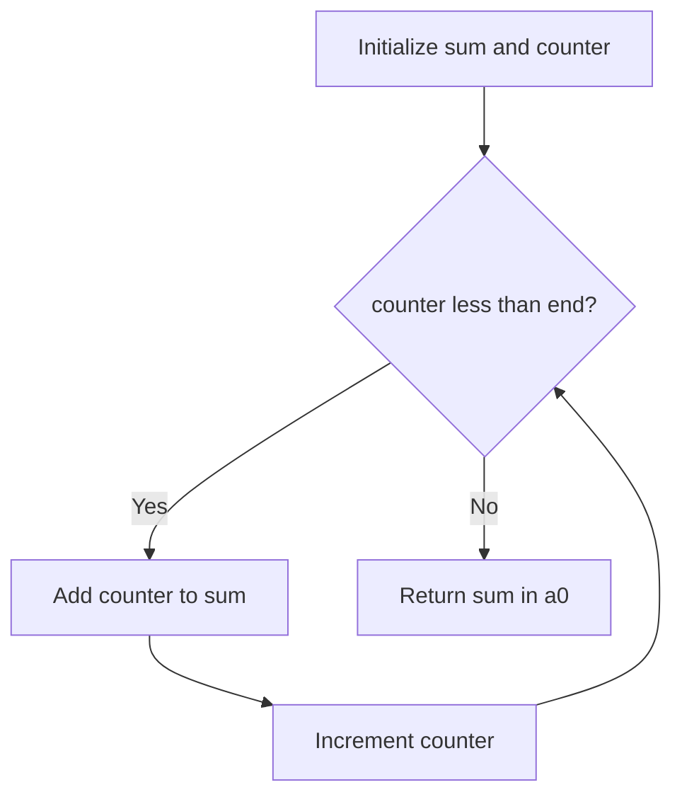

# Assembly Algorithm for Sum 1 to N

## Algorithm
Use a half-open interval [start, end). For the workshop example, start=0 and end=10 produce the sum 45, equivalent to summing 1 through 9.

| Counter added | Accumulator |
|---|---|
| 0 | 0 |
| 1 | 1 |
| 2 | 3 |
| 3 | 6 |
| 9 | 45 |

The implementation in the next document uses temporary registers for the loop and checks the condition before adding, so an empty interval returns zero. This is an independently written variant of the workshop algorithm.

## Workshop reference
Topic sequence based on the [Day 2 workshop notes](https://github.com/chinmaya24163/NASSCOM-RISC-V-MYTH/tree/main/day2). Explanations and examples are independently written; no reference screenshots or results are reproduced.
