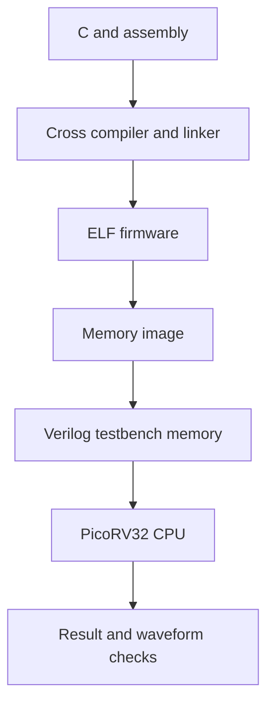

# RISC-V CPU Verification

## From instruction simulation to RTL simulation
Spike models instruction execution. An RTL simulator instead executes the Verilog hardware model, allowing observation of clocks, reset, memory transactions and internal signals.



## Reproduction workflow
1. Obtain the PicoRV32 core and compatible testbench.
2. Build RV32 firmware with a matching linker script, startup code and supported ISA.
3. Convert the ELF to the memory format expected by the testbench.
4. Load the image into simulated memory.
5. Compile the RTL and testbench with Icarus Verilog and execute the resulting VVP file.

Illustrative commands, assuming the testbench and firmware are already prepared:

```bash
iverilog -g2012 -s testbench -o sim.vvp testbench.v picorv32.v
vvp sim.vvp
```

A firmware HEX file is a memory initialization image, not an FPGA configuration bitstream. The testbench must define how completion and output are detected. A bare-metal program using printf requires suitable runtime/output support.

## Verification status
The workshop reference describes a PicoRV32 simulation. The exact original firmware, script, testbench and personal output are not available here, so no passing RTL result is claimed.

Reference core: https://github.com/YosysHQ/picorv32

## Workshop reference
Topic sequence based on the [Day 2 workshop notes](https://github.com/chinmaya24163/NASSCOM-RISC-V-MYTH/tree/main/day2). Explanations and examples are independently written; no reference screenshots or results are reproduced.
