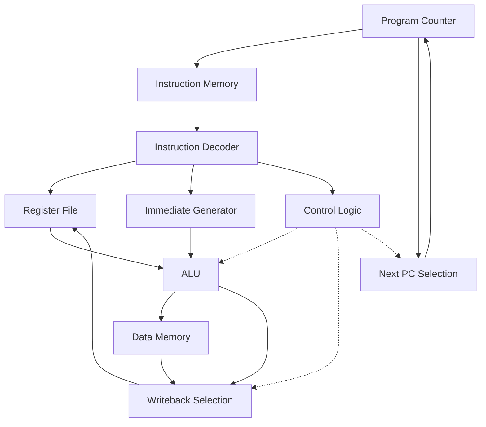

# Lecture 34 - Understanding Single-Cycle RISC-V Processor Architecture

## Introduction

This lecture focuses on the internal architecture of a basic RISC-V processor and explains how different hardware blocks work together to execute an instruction.

The concepts studied in the previous sessions, such as combinational logic, sequential circuits, multiplexers and timing stages, form the foundation of processor design.

## 1. Instruction Set Architecture and Microarchitecture

The Instruction Set Architecture (ISA) defines the instructions supported by a processor and their expected behaviour.

Microarchitecture describes the internal hardware organization used to implement the ISA.

Different processor architectures can implement the same RISC-V instruction set.

## 2. Basic Processor Datapath

The major functional units of a single-cycle processor are:

| Hardware Unit | Function |
|---------------|----------|
| Program Counter | Maintains the instruction address |
| Instruction Memory | Supplies the instruction to be executed |
| Decoder | Identifies instruction type and operands |
| Register File | Stores register values |
| Immediate Generator | Extracts immediate operands |
| ALU | Performs arithmetic and logical operations |
| Data Memory | Supports load and store operations |
| Control Unit | Generates datapath control signals |
| Writeback Unit | Updates the destination register |

## 3. Instruction Execution Flow

The basic instruction execution sequence can be represented as:



## 4. Program Counter Operation

The Program Counter holds the address of the instruction being fetched.

For sequential execution of 32-bit instructions, the PC is incremented by four bytes.

```
Next PC = Current PC + 4
```

For branch instructions, the next address is selected according to the branch condition.

```
Branch Target = Current PC + Immediate Offset
```

## 5. Instruction Decoding

A RISC-V instruction contains different fields that determine the operation and register addresses.

For an R-type instruction:

| Field | Bit Position |
|-------|--------------|
| Opcode | 6:0 |
| rd | 11:7 |
| funct3 | 14:12 |
| rs1 | 19:15 |
| rs2 | 24:20 |
| funct7 | 31:25 |

The decoder interprets these fields and generates the required control signals.

## 6. Register File and ALU

The RV32I architecture contains 32 integer registers of 32 bits each.

The register file generally supports two read ports and one write port in a basic processor design.

The ALU receives operands from the register file or immediate generator and performs the operation specified by the instruction.

## 7. Example of Arithmetic Instruction Execution

Consider the instruction:

```asm
add x7, x5, x6
```

Assume:

- x5 = 12
- x6 = 8

Instruction execution:

1. Fetch the instruction from instruction memory.
2. Decode the opcode and register addresses.
3. Read the contents of x5 and x6.
4. Perform addition using the ALU.
5. Write the result into x7.
6. Update the Program Counter.

Expected result:

```
x7 = 12 + 8 = 20
```

## 8. Memory Access Instructions

### Load Operation

```asm
lw x7, 12(x5)
```

The ALU calculates the effective memory address by adding the base register value and immediate offset.

The data obtained from memory is written into the destination register.

### Store Operation

```asm
sw x7, 12(x5)
```

The effective address is calculated using the ALU.

The contents of x7 are written into the corresponding data memory location.

| Load Instruction | Store Instruction |
|------------------|-------------------|
| Reads data from memory | Writes data into memory |
| Updates destination register | Does not update destination register |
| Memory-to-register transfer | Register-to-memory transfer |

## 9. Branch Execution

Branch instructions modify the normal instruction execution sequence based on a condition.

Example:

```asm
beq x5, x6, target
```

If the register values are equal, the processor redirects execution to the branch target. Otherwise, execution continues with the next sequential instruction.

## 10. Single-Cycle Execution

In a conventional single-cycle processor, instruction fetch, decoding, execution, memory access and writeback are completed within one clock period.

The clock period must accommodate the longest instruction execution path.

This architecture provides a simple starting point for understanding processor design before introducing pipelining.

A synchronous instruction memory with a registered read output requires additional fetch timing considerations.

## 11. Basic PC Implementation in TL-Verilog

The following example demonstrates sequential instruction address generation.

```verilog
\m4_TLV_version 1d: tl-x.org
\SV
   m4_makerchip_module
\TLV
   |cpu
      @0
         $reset = *reset;

         $next_pc[31:0] = $pc + 32'd4;

         $pc[31:0] = $reset ? 32'd0 : >>1$next_pc;
\SV
endmodule
```

### Expected PC Sequence

| Clock Cycle | PC (Hexadecimal) |
|-------------|------------------|
| 0 | 00000000 |
| 1 | 00000004 |
| 2 | 00000008 |
| 3 | 0000000C |
| 4 | 00000010 |
| 5 | 00000014 |

## 12. Architecture Diagram


## 13. Learning Outcomes

From this lecture, I understood:

- The relationship between ISA and processor microarchitecture.
- The role of the Program Counter in instruction sequencing.
- Instruction decoding and operand extraction.
- Register file organization and ALU functionality.
- Effective address computation for load and store instructions.
- Branch target calculation.
- Register writeback and architectural state updates.
- The basic execution model of a single-cycle processor.

## Conclusion

This session provides the architectural foundation for implementing a RISC-V processor using TL-Verilog.

The individual digital circuits studied in earlier sessions can now be integrated to form a functional processor datapath.

The single-cycle design also serves as a starting point for developing more advanced pipelined processor architectures.

## Reference

RISC-V Processor Design Training - Lecture 34:
Architecture of a Single-Cycle RISC-V CPU.
