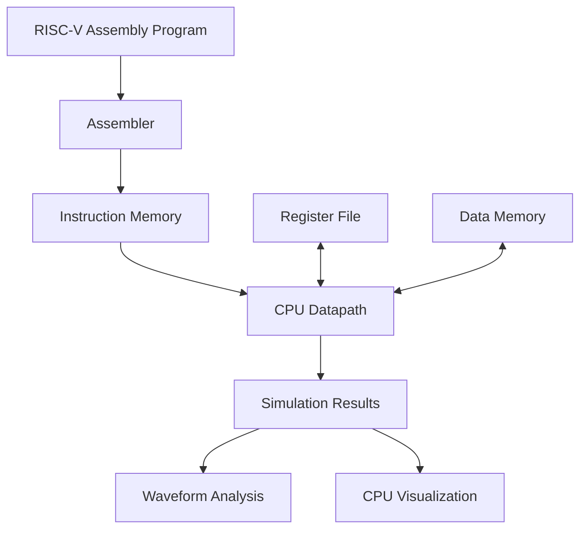

# Lecture 35 - Getting Started with RISC-V CPU Implementation

## Objective

The objective of this session is to become familiar with the RISC-V processor development environment provided in Makerchip.

After studying the single-cycle processor architecture in the previous lecture, this session introduces the starter framework required for practical CPU implementation.

## 1. RISC-V Processor Development Framework

The workshop provides a reusable CPU shell containing essential hardware components and supporting tools.

This framework reduces the effort required to develop common infrastructure and allows the learner to concentrate on implementing the processor datapath and control logic.

## 2. Infrastructure Available in the CPU Shell

| Module | Description |
|--------|-------------|
| Instruction Memory | Holds the assembled program instructions |
| Register File | Supports register operand reads and result writes |
| Data Memory | Provides storage for memory access instructions |
| Assembler | Translates RISC-V assembly into machine instructions |
| M4 Macros | Simplifies reusable hardware infrastructure |
| Visualization | Provides graphical representation of CPU execution |
| Reference Solutions | Supports learning and implementation verification |

## 3. Development Workflow



## 4. Role of the M4 Preprocessor

The Makerchip environment uses M4 macros to generate reusable hardware and simulation infrastructure.

Macros help reduce repetitive code and simplify the integration of processor components.

The CPU shell includes predefined macros for supporting the workshop implementation.

## 5. Program Initialization

The instruction memory is initialized with machine instructions generated by the assembler.

The starter framework includes a test program that calculates the sum of integers from 1 to 9.

The expected result is:

```
Sum = 1 + 2 + 3 + 4 + 5 + 6 + 7 + 8 + 9
Sum = 45
Hexadecimal result = 0x2D
```

## 6. Illustrative RISC-V Assembly Program

The following example demonstrates an equivalent summation operation.

```asm
addi x1, x0, 0
addi x2, x0, 1
addi x3, x0, 10

loop:
    add  x1, x1, x2
    addi x2, x2, 1
    blt  x2, x3, loop
```

### Register Allocation

| Register | Function |
|----------|----------|
| x0 | Constant zero |
| x1 | Accumulated sum |
| x2 | Loop counter |
| x3 | Loop termination limit |

### Expected Accumulation

| Iteration | Sum (Decimal) | Sum (Hexadecimal) |
|-----------|---------------|-------------------|
| 1 | 1 | 01 |
| 2 | 3 | 03 |
| 3 | 6 | 06 |
| 4 | 10 | 0A |
| 5 | 15 | 0F |
| 6 | 21 | 15 |
| 7 | 28 | 1C |
| 8 | 36 | 24 |
| 9 | 45 | 2D |

This program is an illustrative example and is not a reproduction of the original workshop assembly code.

## 7. Register and Memory Infrastructure

The register file provides access to the operands required for instruction execution and stores the results generated by the processor.

Instruction memory supplies the machine instructions, while data memory supports load and store operations.

These predefined components will be connected to the processor logic during the upcoming implementation sessions.

## 8. Simulation and Debugging

Makerchip provides multiple views for examining hardware behaviour.

| Tool | Application |
|------|-------------|
| Editor | TL-Verilog implementation |
| NAV-TLV | Design hierarchy inspection |
| Waveform | Signal and timing verification |
| Diagram | Hardware connectivity analysis |
| Visualization | Processor execution monitoring |
| Log | Compilation and simulation diagnostics |

## 9. Practical Observations

The CPU shell provides the necessary starting environment for developing a RISC-V processor.

The instruction memory, register file and data memory infrastructure are available for integration with the processor datapath.

The upcoming implementation steps involve developing instruction fetch, decoding, arithmetic operations, branch handling and writeback logic.

## 10. Learning Outcomes

- Understanding the organization of a reusable CPU shell.
- Familiarization with M4 macro-based infrastructure.
- Understanding assembly-to-machine-code conversion.
- Understanding instruction memory initialization.
- Familiarization with register file and data memory support.
- Understanding visualization-assisted hardware debugging.
- Preparation for implementing the RISC-V processor datapath.

## Conclusion

This lecture establishes the practical development environment for RISC-V CPU implementation.

The predefined infrastructure allows processor development to proceed incrementally, starting with instruction sequencing and extending towards a functional CPU.

## Reference

RISC-V Processor Design Training
Lecture 35 - RISC-V Labs Part 1.
