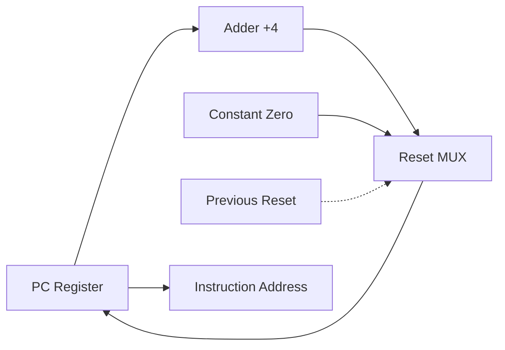
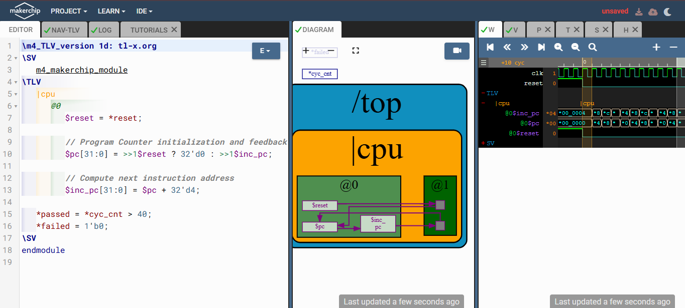

# 37 - Implementation of Next PC Logic

## Introduction

This lab introduces the first stage of RISC-V processor implementation using TL-Verilog in Makerchip.

The main objective is to design the Program Counter (PC), which determines the sequence of instruction addresses during program execution.

At this stage, only sequential instruction execution is considered. Branch instructions will be incorporated in subsequent labs.

---

## Program Counter Operation

The Program Counter is a 32-bit register that holds the address of the instruction to be fetched from instruction memory.

Since each instruction in this lab occupies 32 bits (4 bytes), the PC is incremented by four for every sequential instruction.

```text
Next PC = Current PC + 4
```

The instruction addresses therefore follow the sequence:

```text
0 → 4 → 8 → 12 → 16 → 20 → ...
```

---

## Hardware Architecture

The PC generation circuit consists of:

- A 32-bit register for storing the instruction address.
- An adder for calculating the next sequential address.
- A multiplexer for reset-controlled address selection.
- A feedback path for continuous instruction sequencing.



---

## Importance of Reset Timing

The processor must begin execution from address zero.

If the current reset signal is used directly in the PC expression, the first active transaction may start from address four instead of address zero in the workshop implementation.

This would result in skipping the first instruction.

To overcome this issue, the reset value of the previous transaction is used for PC initialization.

In TL-Verilog, the `>>1` operator provides access to the previous transaction.

---

## TL-Verilog Implementation

The following logic is added to the CPU starter shell at pipeline stage @0.

```verilog
|cpu
   @0
      $reset = *reset;

      // Select the current instruction address
      $pc[31:0] = >>1$reset ? 32'd0 : >>1$inc_pc;

      // Compute the next sequential address
      $inc_pc[31:0] = $pc + 32'd4;
```

### Signal Description

| Signal | Description |
|--------|-------------|
| $reset | Reset signal obtained from Makerchip |
| $pc | Current 32-bit instruction address |
| $inc_pc | Incremented Program Counter |
| >>1$reset | Reset value of the previous transaction |
| >>1$inc_pc | Incremented PC from the previous transaction |

The incremented PC is calculated separately to simplify waveform analysis and debugging.

---

## Expected Clock Cycle Behaviour

| Clock Cycle | Current Reset | Previous Reset | PC | Incremented PC |
|-------------|---------------|----------------|----|----------------|
| 1 | 1 | 1 | 0 | 4 |
| 2 | 1 | 1 | 0 | 4 |
| 3 | 0 | 1 | 0 | 4 |
| 4 | 0 | 0 | 4 | 8 |
| 5 | 0 | 0 | 8 | 12 |
| 6 | 0 | 0 | 12 | 16 |
| 7 | 0 | 0 | 16 | 20 |

The first non-reset transaction receives address zero, ensuring that the initial instruction is not skipped.

---

## Makerchip Implementation




### Expected Waveform Values

Makerchip displays the PC values in hexadecimal.

```text
PC       : 00  04  08  0C  10  14  18
INC_PC   : 04  08  0C  10  14  18  1C
```

The waveform should demonstrate sequential address generation with a four-byte increment after reset.

---

## Functional Verification

The following conditions are checked during simulation:

- The Program Counter starts at address zero.
- The first active transaction does not skip the initial instruction.
- The PC increments by four bytes during sequential execution.
- The incremented PC is correctly fed back to the next transaction.

---

## Learning Outcomes

- Understanding the role of the Program Counter in a RISC-V processor.
- Understanding byte-addressed instruction memory.
- Implementation of sequential instruction address generation.
- Understanding previous transaction references in TL-Verilog.
- Understanding reset-controlled multiplexing.
- Implementation of state recirculation through feedback.
- Verification of PC behaviour using simulation waveforms.

---

## Conclusion

The Next PC logic establishes the basic instruction sequencing mechanism of the RISC-V processor.

The use of previous-transaction reset handling ensures that execution begins at the correct instruction address.

This implementation forms the foundation for the next lab, which involves fetching instructions from instruction memory.

---

## References

- RISC-V MYTH Workshop by Steve Hoover, Redwood EDA.
- Workshop PDF, Page 6 - Lab: Next PC.
- [Official RISC-V MYTH Workshop](https://github.com/stevehoover/RISC-V_MYTH_Workshop)
- [Makerchip IDE](https://makerchip.com/)
