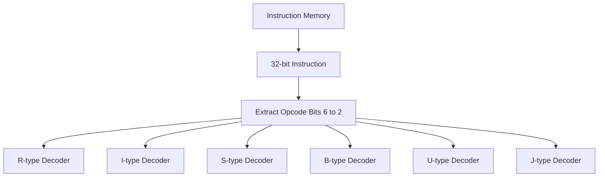

# 39 - RISC-V Instruction Type Decoder

## Objective

The objective of this lab is to implement combinational
instruction type decoding for the RISC-V processor using
TL-Verilog in Makerchip.

This experiment extends the instruction fetch mechanism
implemented in the previous lab.

---

## Instruction Classification

RISC-V instructions are classified into six basic formats.

| Format | Description | Example |
|--------|-------------|---------|
| R | Register arithmetic | ADD |
| I | Immediate operations | ADDI |
| S | Store operations | SW |
| B | Conditional branch | BEQ |
| U | Upper immediate | LUI |
| J | Jump operation | JAL |

The instruction format determines how the remaining
instruction fields must be interpreted.

---

## Opcode Extraction

The opcode occupies bits [6:0] of a 32-bit RISC-V instruction.

Since the lowest two bits of standard 32-bit RV32I
instructions are 11, bits [6:2] are used for major opcode
classification in this experiment.

A separate five-bit signal is introduced to simplify
instruction decoding and waveform analysis.

```verilog
$opcode5[4:0] = $instr[6:2];
```

---

## Decoder Architecture



All instruction type comparators operate in parallel.

---

## TL-Verilog Implementation

The decoder is implemented at pipeline stage @1,
immediately after instruction retrieval.

```verilog
$opcode5[4:0] = $instr[6:2];

// Register format
$is_r_instr = $opcode5 == 5'b01100;

// Immediate format
$is_i_instr = ($opcode5 == 5'b00100) ||
              ($opcode5 == 5'b00000) ||
              ($opcode5 == 5'b11001) ||
              ($opcode5 == 5'b11100) ||
              ($opcode5 == 5'b00011);

// Store format
$is_s_instr = $opcode5 == 5'b01000;

// Branch format
$is_b_instr = $opcode5 == 5'b11000;

// Upper immediate format
$is_u_instr = $opcode5 ==? 5'b0x101;

// Jump format
$is_j_instr = $opcode5 == 5'b11011;
```

---

## Wildcard Comparison

The wildcard equality operator (==?) allows selected
bits to be treated as don't-care values.

For example:

```verilog
$is_u_instr = $opcode5 ==? 5'b0x101;
```

This expression matches both:

- 00101 - AUIPC
- 01101 - LUI

Both instructions belong to the U-type format.

---

## Decoder Output Signals

| Signal | Function |
|--------|----------|
| $opcode5 | Extracted major opcode |
| $is_r_instr | Register instruction indicator |
| $is_i_instr | Immediate instruction indicator |
| $is_s_instr | Store instruction indicator |
| $is_b_instr | Branch instruction indicator |
| $is_u_instr | Upper immediate instruction indicator |
| $is_j_instr | Jump instruction indicator |

---


---

## Expected Functional Behaviour

The existing summation program contains ADD, ADDI and BLT
instructions.

The expected decoder outputs are:

| Instruction | R | I | S | B | U | J |
|-------------|---|---|---|---|---|---|
| ADD | 1 | 0 | 0 | 0 | 0 | 0 |
| ADDI | 0 | 1 | 0 | 0 | 0 | 0 |
| BLT | 0 | 0 | 0 | 1 | 0 | 0 |

The remaining format indicators are expected to stay
inactive for the current test program.

---

## Learning Outcomes

- Understanding RISC-V instruction formats.
- Extracting opcode bits from machine instructions.
- Implementing combinational instruction classification.
- Understanding wildcard equality comparisons.
- Generating instruction type control signals.
- Analyzing decoder outputs using simulation waveforms.
- Understanding parallel hardware comparisons.

---

## Conclusion

This experiment introduces the instruction interpretation
stage of the RISC-V processor.

The decoder classifies fetched instructions into their
corresponding formats using opcode comparisons.

This classification provides the foundation for subsequent
instruction field extraction, register access, immediate
generation and execution logic.

---

## References

- RISC-V MYTH Workshop, Steve Hoover, Redwood EDA.
- https://github.com/stevehoover/RISC-V_MYTH_Workshop
- https://makerchip.com/
