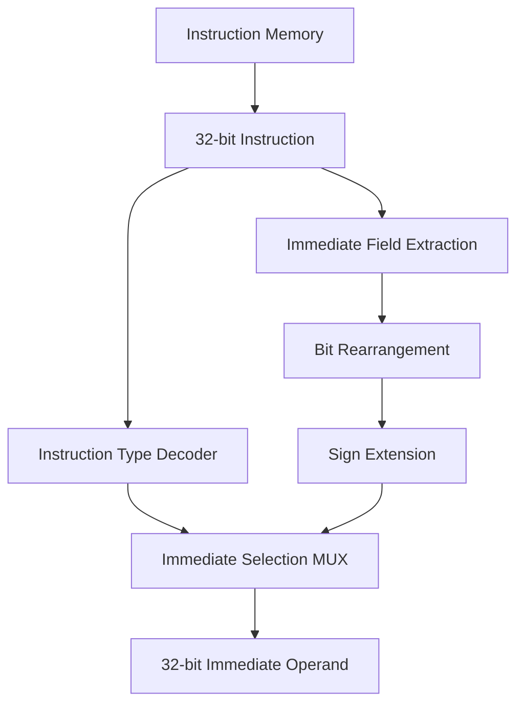
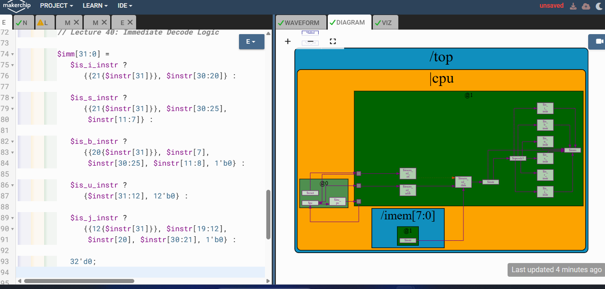

# 40 - Implementation of RISC-V Immediate Decode Logic

## Objective

The objective of this lab is to implement a 32-bit
immediate generation unit for the RISC-V processor
using TL-Verilog in Makerchip.

This experiment extends the instruction type decoder
developed in the previous lab.

---

## Immediate Operands in RISC-V

An immediate is a constant value encoded directly
within a machine instruction.

Immediate operands are used in arithmetic operations,
memory addressing, conditional branches and jump
instructions.

For example:

- ADDI x3, x1, 5 : Immediate value is 5.
- LW x3, 8(x1) : Address offset is 8.
- BLT x13, x12, -8 : Branch offset is -8.

R-type instructions use register operands and do not
require an immediate value.

---

## RISC-V Immediate Formats

The location and arrangement of immediate bits depend
on the instruction format.

| Format | Immediate Width | Application |
|--------|-----------------|-------------|
| I-type | 12 bits | Immediate arithmetic and loads |
| S-type | 12 bits | Store operations |
| B-type | 13 bits | Conditional branches |
| U-type | 20 encoded bits | Upper immediate operations |
| J-type | 21 bits | Jump operations |

The B-type and J-type widths include an implicit
least significant zero bit.

All immediate values are reconstructed as 32-bit
operands for the RV32I processor.

---

## Sign Extension

Sign extension is used to increase the bit width
of a signed binary number without changing its value.

The most significant bit of the immediate is replicated
to fill the additional upper bits.

For example:

| Decimal Value | 12-bit Hex | 32-bit Hex |
|---------------|------------|------------|
| 5 | 005 | 00000005 |
| 10 | 00A | 0000000A |
| -5 | FFB | FFFFFFFB |
| -8 | FF8 | FFFFFFF8 |

The replication expression:

```verilog
{21{$instr[31]}}
```

creates 21 copies of instruction bit 31.

This includes the original sign bit and the additional
20 sign-extension bits for an I-type immediate.

---

## Concatenation and Bit Replication

Concatenation combines separate binary fields into
a single binary value.

For example:

```verilog
{4'b1010, 4'b0011}
```

Output:

```text
10100011
```

Bit replication repeats a particular bit or group
of bits multiple times.

```verilog
{4{1'b1}}
```

Output:

```text
1111
```

Both operations are used in immediate generation
to reconstruct the required instruction fields.

---

## Immediate Generation Architecture



The immediate generation unit uses the instruction
type indicators to select the appropriate immediate
construction.

---

## TL-Verilog Implementation

The immediate generation logic is added at stage @1,
following instruction fetch and instruction type decoding.

```verilog
// Lecture 40: Immediate Decode Logic

$imm[31:0] =
   $is_i_instr ?
      {{21{$instr[31]}}, $instr[30:20]} :

   $is_s_instr ?
      {{21{$instr[31]}}, $instr[30:25],
       $instr[11:7]} :

   $is_b_instr ?
      {{20{$instr[31]}}, $instr[7],
       $instr[30:25], $instr[11:8], 1'b0} :

   $is_u_instr ?
      {$instr[31:12], 12'b0} :

   $is_j_instr ?
      {{12{$instr[31]}}, $instr[19:12],
       $instr[20], $instr[30:21], 1'b0} :

   32'd0;
```

A conditional selection mechanism generates the
appropriate immediate based on the instruction format.

For R-type instructions, the immediate output is zero.

---

## Immediate Field Construction

| Format | Bit Construction |
|--------|------------------|
| I | Sign extension and instruction bits [30:20] |
| S | Sign extension and bits [30:25], [11:7] |
| B | Sign extension, rearranged fields and trailing zero |
| U | Instruction bits [31:12] followed by 12 zeros |
| J | Sign extension, rearranged fields and trailing zero |

The immediate generation process is implemented using
combinational logic without requiring an arithmetic
calculation.

---

## Makerchip Implementation


---

## CPU Visualization


---

## Simulation Waveform


---

## Hardware Diagram



---

## Expected Simulation Results

The existing summation program is used to examine
immediate generation for ADDI and BLT instructions.

| PC (Hex) | Instruction | Immediate (Decimal) | Immediate (Hex) |
|----------|-------------|---------------------|-----------------|
| 00 | ADD | 0 | 00000000 |
| 04 | ADD | 0 | 00000000 |
| 08 | ADDI | 10 | 0000000A |
| 0C | ADD | 0 | 00000000 |
| 10 | ADD | 0 | 00000000 |
| 14 | ADDI | 1 | 00000001 |
| 18 | BLT | -8 | FFFFFFF8 |
| 1C | ADD | 0 | 00000000 |

The negative branch immediate represents a backward
offset of eight bytes.

The branch target can subsequently be calculated using:

```text
Branch Target = PC + Immediate
```

For the summation loop:

```text
Branch Target = 24 + (-8)
              = 16
```

Actual branch execution will be implemented in
subsequent labs.

---

## Current Implementation Status

- [x] Program Counter generation
- [x] Instruction memory integration
- [x] Instruction fetch
- [x] Instruction type classification
- [x] Immediate generation logic
- [ ] Immediate waveform verification
- [ ] Register field decoding
- [ ] Register file access
- [ ] ALU execution
- [ ] Branch execution

---

## Hardware Design Perspective

Immediate generation is primarily a combinational
bit manipulation operation.

The hardware performs:

- Selection of instruction fields.
- Rearrangement of immediate bits.
- Sign extension.
- Concatenation.
- Multiplexer-based operand selection.

The generated immediate operand will be used by
the ALU and address generation logic in later stages.

---

## Learning Outcomes

Through this experiment, I learned:

- How immediate operands are encoded in RISC-V.
- How different instruction formats organize immediate bits.
- How sign extension preserves signed numerical values.
- How concatenation and replication work in TL-Verilog.
- How to reconstruct split immediate fields.
- How to implement instruction-dependent operand selection.
- How to extend the existing RISC-V CPU datapath.

---

## Conclusion

In this lab, the RISC-V CPU implementation was extended
with a 32-bit immediate generation unit.

The decoder reconstructs immediate operands for I, S,
B, U and J instruction formats using combinational
bit manipulation and instruction type selection.

This implementation provides the foundation for
arithmetic execution, memory address calculation,
branch target generation and jump operations.

---

## References

- RISC-V MYTH Workshop - Steve Hoover, Redwood EDA.
- https://github.com/stevehoover/RISC-V_MYTH_Workshop
- https://makerchip.com/
