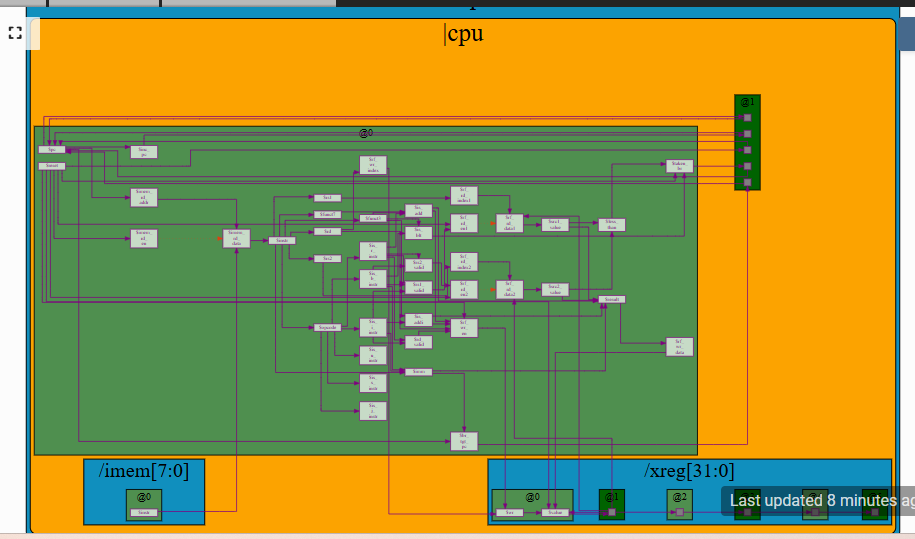
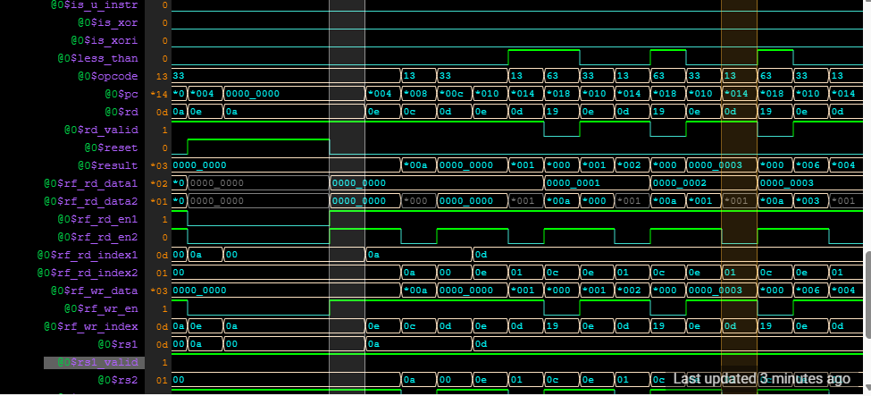

## Complete TL-Verilog Implementation

The complete RISC-V processor implementation used in the Makerchip editor is given below. It includes instruction fetch, instruction decoding, immediate decoding, register file operations, ALU execution, branch control and the self-checking testbench.

```verilog
\m4_TLV_version 1d: tl-x.org
\SV
   // Based on the RISC-V MYTH Workshop shell
   m4_include_lib(['https://raw.githubusercontent.com/BalaDhinesh/RISC-V_MYTH_Workshop/master/tlv_lib/risc-v_shell_lib.tlv'])

\SV
   m4_makerchip_module

\TLV

   // Assembly program: Sum of integers from 1 to 9

   m4_asm(ADD, r10, r0, r0)
   m4_asm(ADD, r14, r10, r0)
   m4_asm(ADDI, r12, r10, 1010)
   m4_asm(ADD, r13, r10, r0)

   // Summation loop

   m4_asm(ADD, r14, r13, r14)
   m4_asm(ADDI, r13, r13, 1)
   m4_asm(BLT, r13, r12, 1111111111000)
   m4_asm(ADD, r10, r14, r0)

   m4_define_hier(['M4_IMEM'], M4_NUM_INSTRS)

   |cpu
      @0
         // Reset

         $reset = *reset;

         // Program Counter with end-of-program hold

         $pc[31:0] = >>1$reset ? 32'd0 :
                     >>1$taken_br ? >>1$br_tgt_pc :
                     (>>1$pc == 32'd28) ? 32'd28 :
                     >>1$inc_pc;

         $inc_pc[31:0] = $pc + 32'd4;

         // Instruction Fetch

         $imem_rd_en = !$reset;

         $imem_rd_addr[M4_IMEM_INDEX_CNT-1:0] =
            $pc[M4_IMEM_INDEX_CNT+1:2];

         $instr[31:0] = $imem_rd_data[31:0];

         // Instruction Type Decode

         $opcode[6:0] = $instr[6:0];

         $is_r_instr = $opcode == 7'b0110011;
         $is_i_instr = $opcode == 7'b0010011;
         $is_s_instr = $opcode == 7'b0100011;
         $is_b_instr = $opcode == 7'b1100011;

         $is_u_instr = ($opcode == 7'b0110111) ||
                       ($opcode == 7'b0010111);

         $is_j_instr = $opcode == 7'b1101111;

         // Instruction Field Decode

         $rs1[4:0] = $instr[19:15];
         $rs2[4:0] = $instr[24:20];
         $rd[4:0] = $instr[11:7];

         $funct3[2:0] = $instr[14:12];
         $funct7[6:0] = $instr[31:25];

         // Immediate Decode

         $imm[31:0] =
            $is_i_instr ?
               {{21{$instr[31]}}, $instr[30:20]} :
            $is_b_instr ?
               {{20{$instr[31]}}, $instr[7],
                $instr[30:25], $instr[11:8], 1'b0} :
            32'd0;

         // Register Field Validity

         $rs1_valid = $is_r_instr ||
                      $is_i_instr ||
                      $is_b_instr;

         $rs2_valid = $is_r_instr ||
                      $is_b_instr;

         $rd_valid = $is_r_instr ||
                     $is_i_instr;

         // Individual Instruction Decode

         $is_add = $is_r_instr &&
                   ($funct3 == 3'b000) &&
                   ($funct7 == 7'b0000000);

         $is_addi = $is_i_instr &&
                    ($funct3 == 3'b000);

         $is_blt = $is_b_instr &&
                   ($funct3 == 3'b100);

         // Register File Read

         $rf_rd_en1 = !$reset && $rs1_valid;
         $rf_rd_index1[4:0] = $rs1;

         $rf_rd_en2 = !$reset && $rs2_valid;
         $rf_rd_index2[4:0] = $rs2;

         $src1_value[31:0] = $rf_rd_data1;
         $src2_value[31:0] = $rf_rd_data2;

         // ALU Operations

         $result[31:0] =
            $is_add ?
               $src1_value + $src2_value :
            $is_addi ?
               $src1_value + $imm :
            32'd0;

         // Register File Write

         $rf_wr_en = !$reset &&
                     $rd_valid &&
                     ($is_add || $is_addi) &&
                     ($rd != 5'd0);

         $rf_wr_index[4:0] = $rd;
         $rf_wr_data[31:0] = $result;

         // Branch Execution
         // Signed less-than comparison

         $less_than = ($src1_value[31] != $src2_value[31]) ?
                      $src1_value[31] :
                      ($src1_value < $src2_value);

         $taken_br = !$reset && $is_blt && $less_than;

         $br_tgt_pc[31:0] = $pc + $imm;

         // Lecture 51: Self-checking Testbench

         *passed = |cpu/xreg[10]>>5$value ==
                   32'd45;

   // Simulation failure signal

   *failed = 1'b0;

   // CPU infrastructure

   |cpu
      m4+imem(@0)
      m4+rf(@0, @0)

   // CPU visualization

   m4+cpu_viz(@4)

\SV
   endmodule
```

### Makerchip Editor Implementation


### Generated CPU Datapath



### Functional Verification

The processor was verified by executing the summation program. The self-checking testbench monitored register x10 and successfully detected the expected result.

| Parameter | Result |
|-----------|--------|
| Expected Output | 45 |
| Observed Output | 45 |
| Hexadecimal Output | 0x0000002D |
| Destination Register | x10 |
| Simulation Status | PASSED |



### Implementation Limitations

The current processor implements ADD, ADDI and BLT instructions required for the summation program. The PC hold condition at address 28 is specific to this test program.

The successful simulation verifies the summation program rather than the complete RV32I instruction set.
