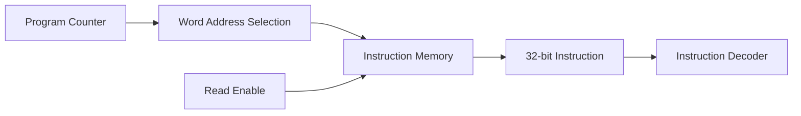
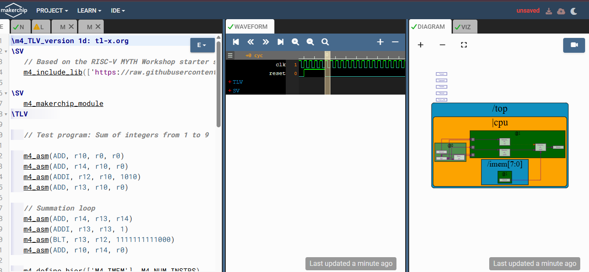

# 38 - RISC-V Instruction Fetch Implementation

## Objective

The objective of this experiment is to integrate instruction memory with the Program Counter and implement instruction retrieval using TL-Verilog.

This lab extends the Next PC logic developed in the previous session.

---

## Instruction Fetch Operation

Instruction fetch is the process of retrieving a machine instruction from instruction memory using the address generated by the Program Counter.

The workshop starter framework contains an instruction memory initialized with a RISC-V assembly program for calculating the sum of integers from 1 to 9.

The processor retrieves these instructions sequentially.

---

## Fetch Datapath



---

## Instruction Memory Addressing

The Program Counter generates byte addresses, whereas the instruction memory array is indexed using instruction words.

Since each instruction occupies four bytes, the lower two PC bits are excluded when generating the instruction memory address.

Memory Index = PC / 4

| PC Address | Instruction Index |
|------------|-------------------|
| 0 | 0 |
| 4 | 1 |
| 8 | 2 |
| 12 | 3 |
| 16 | 4 |
| 20 | 5 |

The address width is determined using the M4_IMEM_INDEX_CNT macro provided by the workshop.

---

## Instruction Memory Interface

| Signal | Direction | Description |
|--------|-----------|-------------|
| $imem_rd_en | Input | Instruction memory read enable |
| $imem_rd_addr | Input | Instruction memory word address |
| $imem_rd_data | Output | Retrieved 32-bit instruction |
| $instr | CPU signal | Instruction supplied to the decoder |

---

## Memory and Visualization Integration

The instruction memory and processor visualization are enabled by uncommenting the following macros in the starter framework.

```verilog
m4+imem(@1)
m4+cpu_viz(@4)
```

---

## TL-Verilog Implementation

```verilog
|cpu
   @0
      $reset = *reset;

      // Sequential PC generation
      $pc[31:0] = >>1$reset ? 32'd0 : >>1$inc_pc;
      $inc_pc[31:0] = $pc + 32'd4;

   @1
      // Enable instruction fetch after reset
      $imem_rd_en = !$reset;

      // Generate instruction memory index
      $imem_rd_addr[M4_IMEM_INDEX_CNT-1:0] =
         $pc[M4_IMEM_INDEX_CNT+1:2];

      // Capture the fetched instruction
      $instr[31:0] = $imem_rd_data[31:0];
```

---

## Pipeline Stage Organization

| Stage | Function |
|-------|----------|
| @0 | Program Counter generation |
| @1 | Instruction memory access and instruction retrieval |

The instruction obtained from memory will be used by the instruction decoder in subsequent labs.

---

## Makerchip Implementation



## Simulation Waveform


## Fetch Datapath


---

## Expected Verification Results

The following conditions are checked during simulation:

- Instruction memory read is enabled after reset.
- Sequential PC addresses increase by four bytes.
- Memory indices increase by one for each sequential instruction.
- The instruction memory output is connected to the instruction signal.
- Instruction values correspond to the initialized program.

---

## Learning Outcomes

- Understanding the instruction fetch mechanism.
- Integration of instruction memory with the CPU datapath.
- Understanding byte-addressed and word-indexed memory.
- Generating aligned instruction memory addresses.
- Implementing reset-controlled memory access.
- Understanding memory interface signals.
- Using Makerchip waveforms for instruction fetch verification.

---

## Conclusion

This experiment establishes the instruction fetch functionality of the RISC-V processor.

The Program Counter generates instruction addresses, which are converted into memory indices to retrieve machine instructions.

The next stage of processor development involves interpreting these instructions through instruction decoding.

---

## References

- Steve Hoover, RISC-V MYTH Workshop, Redwood EDA.
- Workshop PDF, Pages 7 and 8 - Lab: Fetch.
- https://github.com/stevehoover/RISC-V_MYTH_Workshop
- https://makerchip.com/
