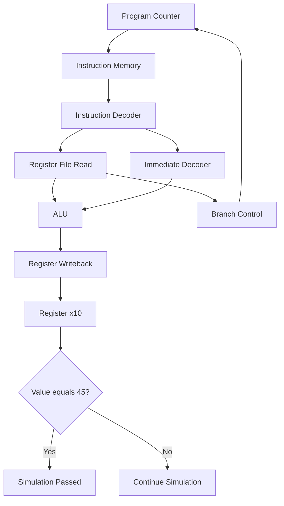

# 51 - RV_D4SK3_L8 - Lab to Create a Simple Testbench

## Objective

The objective of this lab is to implement a self-checking testbench for the developed RISC-V processor and verify its functionality by executing a program that calculates the sum of integers from 1 to 9.

The simulation automatically terminates successfully when the expected result is detected in register x10.

## 1. Test Program

The assembly program used for functional verification is:

```asm
ADD  x10, x0, x0
ADD  x14, x10, x0
ADDI x12, x10, 10
ADD  x13, x10, x0

ADD  x14, x13, x14
ADDI x13, x13, 1
BLT  x13, x12, -8

ADD  x10, x14, x0
```

The program initializes the required registers, performs repeated addition using a branch-controlled loop, and transfers the final accumulated result to register x10.

The expected result is:

1 + 2 + 3 + 4 + 5 + 6 + 7 + 8 + 9 = 45

## 2. Register Allocation

| Register | Purpose |
|----------|---------|
| x0 | Constant zero |
| x10 | Final summation result |
| x12 | Loop limit |
| x13 | Loop counter |
| x14 | Accumulated sum |

## 3. Testbench Implementation

Previously, the simulation termination was based on the number of clock cycles. This does not verify whether the processor has produced the correct output.

A self-checking testbench is implemented by monitoring the value stored in register x10.

```verilog
// Self-checking testbench
*passed = |cpu/xreg[10]>>5$value == 32'd45;
```

The failure signal is defined as:

```verilog
*failed = 1'b0;
```

### Explanation

- `|cpu` represents the CPU pipeline hierarchy.
- `/xreg[10]` selects register x10 from the register file.
- `$value` represents the stored register value.
- `>>5` refers to the value from an earlier transaction, delaying the observation.
- `32'd45` represents the expected 32-bit decimal result.
- `*passed` indicates successful simulation when the comparison evaluates to true.

### Implementation in Makerchip


## 4. CPU Datapath

The implemented processor consists of the following functional units:

- Program Counter
- Instruction Memory
- Instruction Decoder
- Immediate Decoder
- Register File
- Arithmetic Logic Unit
- Branch Control Logic
- Register Writeback Logic
- Self-checking Testbench

The instruction execution flow is:



### Generated Datapath


## 5. Waveform Analysis

The simulation waveform is analyzed to verify instruction execution, register file operations, ALU calculations and branch decisions.


### 5.1 Program Counter and Instruction Execution

The Program Counter increments by four bytes during sequential instruction execution.

| PC Address (Hex) | Instruction | Operation |
|------------------|-------------|-----------|
| 0x00 | ADD x10,x0,x0 | Initialize x10 |
| 0x04 | ADD x14,x10,x0 | Initialize accumulator |
| 0x08 | ADDI x12,x10,10 | Set loop limit |
| 0x0C | ADD x13,x10,x0 | Initialize counter |
| 0x10 | ADD x14,x13,x14 | Accumulate sum |
| 0x14 | ADDI x13,x13,1 | Increment counter |
| 0x18 | BLT x13,x12,-8 | Evaluate branch |
| 0x1C | ADD x10,x14,x0 | Store final result |

The repeated PC sequence observed in the waveform is:

```text
0x10 -> 0x14 -> 0x18 -> 0x10
```

This confirms the repeated execution of the summation loop.

### 5.2 Analysis of the Selected Waveform Cycle

The highlighted waveform interval corresponds to the following instruction:

```asm
ADDI x13, x13, 1
```

The processor reads the current counter value of 2, adds the immediate value 1, and writes the updated value 3 into register x13.

| Signal | Observed Value | Description |
|--------|----------------|-------------|
| `$pc` | 0x14 | Current instruction address |
| `$opcode` | 0x13 | Immediate arithmetic instruction |
| `$rd` | 0x0D | Destination register x13 |
| `$rd_valid` | 1 | Destination register is valid |
| `$rf_rd_en1` | 1 | First register read enabled |
| `$rf_rd_en2` | 0 | Second register read disabled |
| `$rf_rd_index1` | 0x0D | Source register x13 |
| `$rf_rd_data1` | 0x02 | Current counter value |
| `$result` | 0x03 | ALU output |
| `$rf_wr_en` | 1 | Register write enabled |
| `$rf_wr_index` | 0x0D | Destination register x13 |
| `$rf_wr_data` | 0x03 | Updated counter value |

The ALU operation is:

```text
x13 = x13 + 1
    = 2 + 1
    = 3
```

Since ADDI is an immediate-type instruction, only one register read port is required. Therefore, the second register read enable remains low.

### 5.3 Register Field Validity

The waveform also demonstrates the importance of register field validity.

During the BLT instruction, the extracted destination field contains a value, but it is not a valid destination register.

```text
rd_valid = 0
rf_wr_en = 0
```

This prevents unintended register write operations during branch execution.

### 5.4 Branch Execution

The branch instruction compares the loop counter stored in x13 with the loop limit stored in x12.

```asm
BLT x13, x12, -8
```

When x13 is less than x12, the branch is taken.

The branch target is calculated as:

```text
Branch target = Current PC + Immediate
              = 24 + (-8)
              = 16
              = 0x10
```

When the counter reaches 10, the branch is not taken and the processor proceeds to the final ADD instruction.

### 5.5 Accumulation of the Result

The expected accumulation sequence is shown below.

| Counter Value | Accumulated Sum | Hexadecimal |
|---------------|-----------------|-------------|
| 0 | 0 | 0x00 |
| 1 | 1 | 0x01 |
| 2 | 3 | 0x03 |
| 3 | 6 | 0x06 |
| 4 | 10 | 0x0A |
| 5 | 15 | 0x0F |
| 6 | 21 | 0x15 |
| 7 | 28 | 0x1C |
| 8 | 36 | 0x24 |
| 9 | 45 | 0x2D |

## 6. Final Instruction Execution

After completing the summation loop, the processor executes:

```asm
ADD x10, x14, x0
```

The corresponding machine instruction is:

```text
0x00070533
```

The accumulated result stored in register x14 is transferred to register x10.

| Signal | Observed Value |
|--------|----------------|
| Program Counter | 0x0000001C |
| Instruction Memory Address | 7 |
| Instruction | 0x00070533 |
| Source Register 1 | x14 |
| Source Register 2 | x0 |
| Destination Register | x10 |
| Source Operand 1 | 0x0000002D |
| Source Operand 2 | 0x00000000 |
| ALU Result | 0x0000002D |
| Register Write Enable | 1 |
| Register Write Index | 0x0A |
| Register Write Data | 0x0000002D |

The final ALU operation is:

```text
x10 = x14 + x0
    = 45 + 0
    = 45
```


## 7. CPU Visualization

The Makerchip visualization provides a graphical representation of instruction execution, register values and data movement within the processor.

The expected final register values are:

| Register | Decimal | Hexadecimal |
|----------|---------|-------------|
| x0 | 0 | 0x00 |
| x10 | 45 | 0x2D |
| x12 | 10 | 0x0A |
| x13 | 10 | 0x0A |
| x14 | 45 | 0x2D |


## 8. Simulation Results

The processor was compiled using SandPiper and simulated using Verilator in the Makerchip environment.

The self-checking testbench successfully detected the expected summation result.

```text
Simulating and tracing...
Simulation PASSED!!!
```


| Parameter | Result |
|-----------|--------|
| SandPiper Compilation | Successful |
| Verilator Compilation | Successful |
| Expected Result | 45 |
| Observed Result | 45 |
| Hexadecimal Result | 0x2D |
| Destination Register | x10 |
| Simulation Status | PASSED |

Unused instruction-type signals generated non-fatal warnings, which did not affect the successful execution of the test program.

## 9. Implementation Notes

The current implementation supports the ADD, ADDI and BLT instructions required for the summation program.

A test-program-specific PC hold condition is included to prevent instruction memory address wraparound after the final instruction.

```verilog
$pc[31:0] = >>1$reset ? 32'd0 :
            >>1$taken_br ? >>1$br_tgt_pc :
            (>>1$pc == 32'd28) ? 32'd28 :
            >>1$inc_pc;
```

This condition is specific to the current test program and is not a general RISC-V processor halt mechanism.

## 10. Learning Outcomes

Through this lab, I understood:

- The implementation of a self-checking testbench.
- Functional verification of a RISC-V processor.
- Monitoring register values using TL-Verilog hierarchy.
- Reading and interpreting simulation waveforms.
- Verification of register read and write operations.
- Execution of ADD, ADDI and BLT instructions.
- Branch-controlled loop execution.
- Verification of ALU results.
- Automatic detection of successful program execution.

## Conclusion

The self-checking testbench was successfully implemented and verified using Makerchip.

The developed RISC-V processor executed the summation program and produced the expected result of 45 in register x10.

The simulation waveform confirmed the instruction execution sequence, register file operations, ALU calculations and final register writeback.

The successful simulation demonstrates the functional correctness of the implemented processor for the given test program.

## References

- VSD RISC-V MYTH Workshop
- [Makerchip IDE](https://makerchip.com/)
- [RISC-V MYTH Workshop Repository](https://github.com/stevehoover/RISC-V_MYTH_Workshop)
- [Workshop Shell Library Used](https://github.com/BalaDhinesh/RISC-V_MYTH_Workshop)
