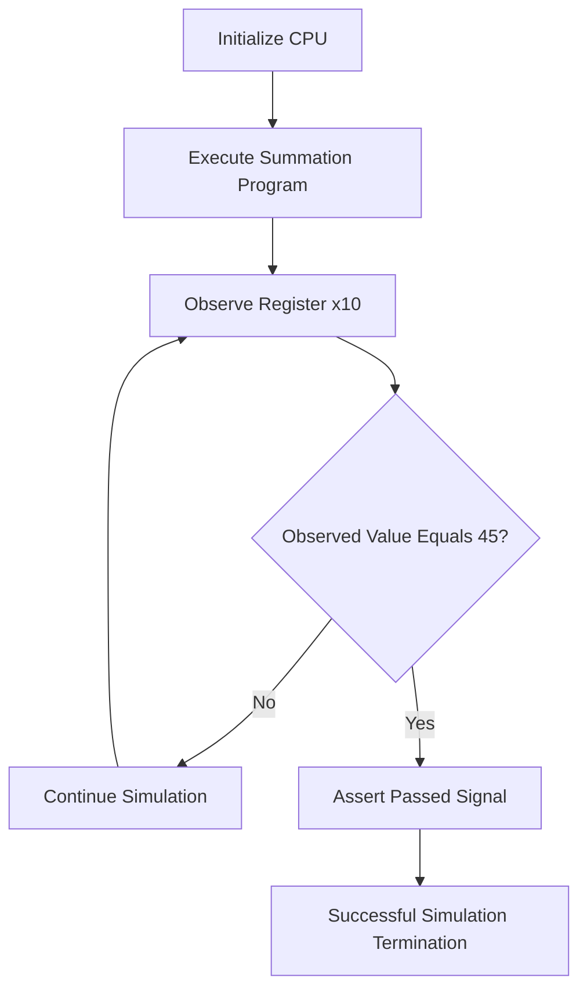

# 51 - Functional Verification Using a Simple CPU Testbench

## Objective

The objective of this experiment is to verify the
functional correctness of the implemented RISC-V
processor using a self-checking simulation mechanism
in Makerchip.

---

## Introduction

After integrating the instruction fetch, decode,
register file, ALU and branch logic, the processor
must be tested using a known assembly program.

The workshop uses a summation program to validate
the interaction between the implemented CPU components.

---

## Test Program

The assembly program calculates the sum of integers
from 1 to 9.

Expected result:

```text
1 + 2 + 3 + 4 + 5 + 6 + 7 + 8 + 9 = 45
```

The accumulated sum is maintained in register x14
and transferred to register x10 after loop completion.

| Register | Function |
|----------|----------|
| x0 | Constant zero |
| x10 | Final output |
| x12 | Loop limit |
| x13 | Loop counter |
| x14 | Accumulated sum |

---

## Need for Functional Verification

The earlier simulation termination condition was:

```verilog
*passed = *cyc_cnt > 40;
```

This condition terminates simulation based on
the number of elapsed clock cycles.

However, it does not validate whether the processor
has generated the expected result.

A register-based comparison is therefore introduced
to verify actual program execution.

---

## Testbench Implementation

The following verification logic is added within
stage @1 of the CPU pipeline.

```verilog
// Functional verification of the summation program

*passed = |cpu/xreg[10]>>5$value == 32'd45;
```

The testbench monitors the value stored in
register x10 and compares it with the expected
summation result.

---

## Delayed Register Observation

The TL-Verilog ahead reference operator:

```verilog
>>5$value
```

is used to observe an earlier register value.

This delayed observation provides additional
waveform visibility before simulation termination.

---

## Verification Flow



---

## Expected Output

| Parameter | Expected Value |
|-----------|----------------|
| Destination register | x10 |
| Decimal result | 45 |
| Hexadecimal result | 0x0000002D |
| Passed signal | 1 |

---

## Makerchip Implementation


---

## Hardware Datapath


---

## Simulation Log


---

## CPU Visualization


---

## Learning Outcomes

- Understanding the purpose of a hardware testbench.
- Implementing automated simulation validation.
- Monitoring architectural register values.
- Comparing actual and expected results.
- Understanding delayed register observation.
- Verifying assembly program execution.
- Using Makerchip simulation pass signals.
- Debugging the integrated RISC-V processor.

---

## Conclusion

This experiment introduces a self-checking
verification mechanism for the RISC-V processor.

The testbench compares the final summation result
stored in register x10 against the expected value.

A successful test provides evidence that the
implemented CPU components work together correctly
for the selected summation program.

Further test programs are required to validate
additional RISC-V instructions and corner cases.

---

## References

- RISC-V MYTH Workshop, Steve Hoover, Redwood EDA.
- https://github.com/stevehoover/RISC-V_MYTH_Workshop
- https://makerchip.com/
