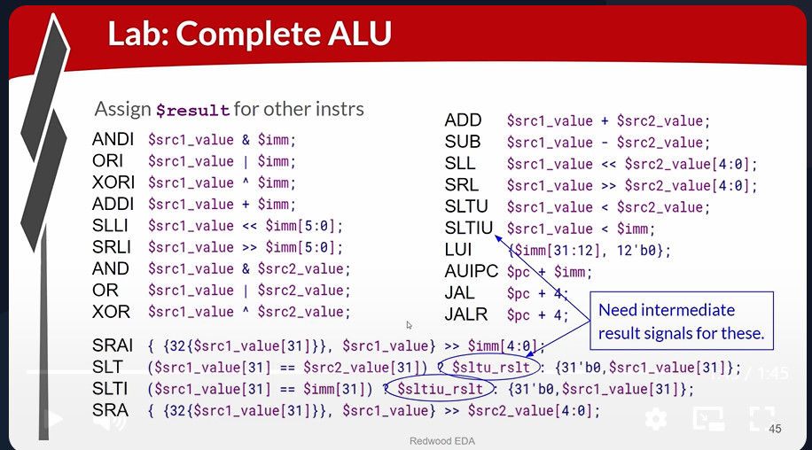

# 59 - RV_D5SK2_L4 - Lab to Code Complete ALU

## Objective

The objective of this lab is to extend the Arithmetic Logic Unit of the previously developed RISC-V processor to support additional RV32I computational instructions.

## 1. Introduction

The earlier ALU implementation supported ADD and ADDI instructions.

In this lab, the ALU is extended to support arithmetic, logical, shift and comparison operations.

## 2. Supported Instructions

### R-Type Instructions

- ADD
- SUB
- AND
- OR
- XOR
- SLL
- SRL
- SRA
- SLT
- SLTU

### I-Type Computational Instructions

- ADDI
- ANDI
- ORI
- XORI
- SLLI
- SRLI
- SRAI
- SLTI
- SLTIU

## 3. Verilog Operator Mapping

| Operation | Verilog Operator |
|-----------|------------------|
| Addition | `+` |
| Subtraction | `-` |
| AND | `&` |
| OR | `\|` |
| XOR | `^` |
| Logical left shift | `<<` |
| Logical right shift | `>>` |
| Arithmetic right shift | `>>>` |
| Less than | `<` |

## 4. Instruction Decoding

The opcode, funct3 and funct7 fields are used to identify the required ALU operation.

R-type instructions use two register operands.

I-type computational instructions use one register operand and an immediate value.

## 5. ALU Operand Selection

A multiplexer selects either the second register operand or the immediate value.

This allows register-register and register-immediate instructions to share the same ALU hardware.

## 6. Arithmetic and Logical Operations

The ALU performs addition, subtraction, AND, OR and XOR operations using native Verilog operators.

## 7. Shift Operations

The processor supports:

- Shift Left Logical (SLL and SLLI)
- Shift Right Logical (SRL and SRLI)
- Shift Right Arithmetic (SRA and SRAI)

RV32I shift operations use a five-bit shift amount.

Arithmetic right shift preserves the sign of the operand.

## 8. Comparison Operations

SLT and SLTI perform signed comparisons.

SLTU and SLTIU perform unsigned comparisons.

The result is 1 when the comparison condition is true and 0 otherwise.

## 9. ALU Result Selection

The decoded instruction determines which arithmetic, logical, shift or comparison result is selected for register writeback.

## 10. Expected Verification Results

| Instruction | Operand A | Operand B | Expected Result |
|-------------|-----------|-----------|-----------------|
| ADD | 12 | 5 | 17 |
| SUB | 12 | 5 | 7 |
| AND | 12 | 5 | 4 |
| OR | 12 | 5 | 13 |
| XOR | 12 | 5 | 9 |
| SLL | 5 | 2 | 20 |
| SRL | 20 | 2 | 5 |
| SRA | -8 | 2 | -2 |
| SLT | -1 | 5 | 1 |
| SLTU | -1 | 5 | 0 |

## Learning Outcomes

Through this lab, I learned:

- ALU architecture and functionality.
- R-type and I-type instruction execution.
- Arithmetic and logical operations.
- Logical and arithmetic shift operations.
- Signed and unsigned comparisons.
- ALU operand selection.
- ALU result selection and register writeback.

## Conclusion

Extending the ALU enables the RISC-V processor to execute a wider range of computational instructions.

The implementation provides the foundation for supporting more complex programs and additional processor functionality.

## References

- VSD RISC-V MYTH Workshop
- [Makerchip IDE](https://makerchip.com/)
- [RISC-V MYTH Workshop](https://github.com/stevehoover/RISC-V_MYTH_Workshop)
