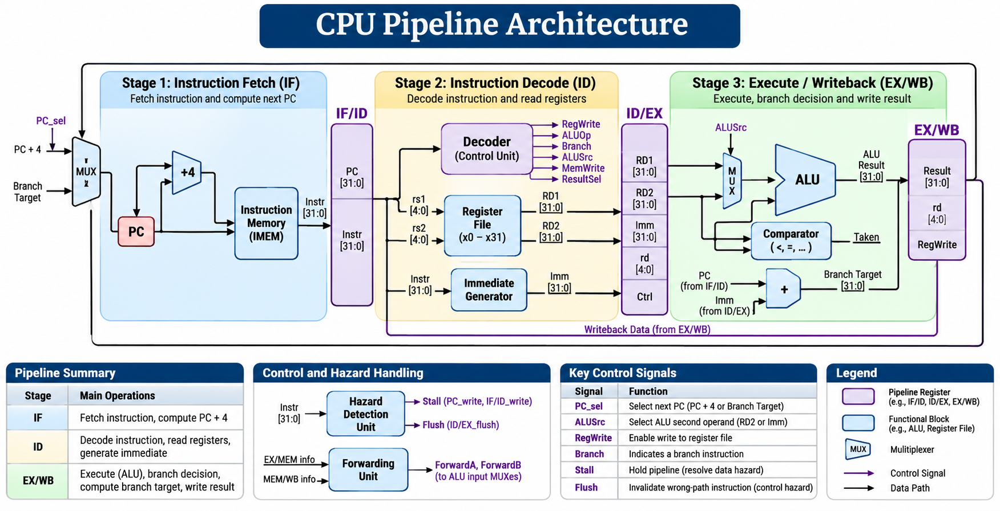

# 52 - RV_D5SK1_L1 - Introduction to Control Flow Hazard and Read-After-Write Hazard

## Objective

The objective of this lecture is to understand the importance of CPU pipelining and the timing dependencies introduced by overlapped instruction execution.

The lecture extends the previously implemented RISC-V processor towards a pipelined architecture.

## 1. Introduction to Pipelining

In a single-cycle processor, instruction fetch, decoding, register reading, execution and register writeback are performed within one clock cycle.

The clock period is limited by the longest combinational path.

Pipelining divides the datapath into smaller stages separated by pipeline registers. This reduces the combinational delay per stage and potentially increases the operating clock frequency.



## 2. Motivation for Pipelining

The major advantages of pipelining are:

- Reduction in combinational delay per stage.
- Higher potential operating clock frequency.
- Improved instruction throughput.
- Simultaneous processing of multiple instructions.
- Better utilization of processor hardware.

Pipelining improves throughput but does not necessarily reduce the latency of an individual instruction.

## 3. Waterfall Pipeline Representation

A waterfall diagram illustrates instruction execution across multiple clock cycles.

The following table represents a conceptual three-stage pipeline.

| Instruction | Cycle 1 | Cycle 2 | Cycle 3 | Cycle 4 | Cycle 5 | Cycle 6 |
|-------------|---------|---------|---------|---------|---------|---------|
| I1 | IF | ID | EX | | | |
| I2 | | IF | ID | EX | | |
| I3 | | | IF | ID | EX | |
| I4 | | | | IF | ID | EX |

Where:

- IF: Instruction Fetch
- ID: Instruction Decode and Register Read
- EX: Execution and Writeback

During cycle 3, three instructions are processed simultaneously in different stages.


## 4. Performance Improvement

Consider an illustrative processor with a total combinational delay of 12 ns.

For a single-cycle implementation:

    Clock period = 12 ns
    Maximum frequency = 83.33 MHz

If the logic is divided into three balanced pipeline stages:

    Ideal stage delay = 4 ns
    Ideal maximum frequency = 250 MHz

The theoretical frequency improvement is three times, assuming negligible pipeline register overhead.

These values are illustrative and are not measured hardware timing results.

## 5. Pipeline Hazards

Pipeline hazards occur when instruction dependencies prevent correct overlapped execution.

The two hazards discussed in this lecture are:

1. Control flow hazard
2. Read-after-write hazard

## 6. Control Flow Hazard

A control flow hazard occurs when the processor must select the next instruction address before the branch decision or branch target becomes available.

Consider the following instructions from the previously implemented summation program:

```asm
BLT x13, x12, -8
ADD x10, x14, x0
```

If the branch condition is satisfied, execution returns to PC address 0x10.

Otherwise, execution continues to PC address 0x1C.

In a pipelined processor, the next sequential instruction may already have been fetched before the branch decision is available.

This creates a possibility of executing instructions from an incorrect path.


Possible solutions include:

- Pipeline stalling
- Pipeline flushing
- Instruction invalidation
- Branch prediction

## 7. Read-After-Write Hazard

A read-after-write (RAW) hazard occurs when an instruction attempts to read a register before a previous instruction has completed writing its updated value.

Consider the following instructions:

```asm
ADDI x13, x13, 1
BLT  x13, x12, -8
```

Assume the initial register values are:

    x13 = 9
    x12 = 10

The ADDI instruction updates x13 to 10.

The BLT instruction must use the updated value of x13.

Correct comparison:

    10 < 10 = False

Incorrect comparison using the old value:

    9 < 10 = True

Reading the old register value can therefore result in an incorrect branch decision.


## 8. Hazard Resolution Techniques

### Pipeline Stalling

The dependent instruction is delayed until the required operand becomes available.

### Data Forwarding

The computed result is transferred directly from the producing instruction to the dependent instruction without waiting for normal register writeback.

These techniques help maintain correct execution when instructions overlap.

## 9. Comparison of Hazards

| Parameter | Control Flow Hazard | RAW Hazard |
|-----------|---------------------|------------|
| Dependency | Control dependency | Data dependency |
| Cause | Delayed branch decision | Delayed register update |
| Affected hardware | PC and branch logic | Register file and ALU |
| Effect | Incorrect instruction path | Incorrect operand value |
| Possible solution | Flush or stall | Forwarding or stall |

## 10. Relevance to the Developed RISC-V Processor

The previously implemented RISC-V processor executes a summation program using ADD, ADDI and BLT instructions.

When this processor is divided into pipeline stages, dependencies between these instructions must be handled correctly.

In particular:

- ADDI produces the updated loop counter.
- BLT requires the updated loop counter.
- BLT determines the next program counter.
- ADD stores the final accumulated result.

Correct handling of data and control dependencies is therefore necessary to preserve the functionality of the processor after pipelining.

## Learning Outcomes

Through this lecture, I understood:

- The motivation behind CPU pipelining.
- Partitioning of processor logic into pipeline stages.
- Waterfall representation of instruction execution.
- Overlapped instruction execution.
- Instruction throughput and clock frequency improvement.
- Control flow hazards.
- Read-after-write hazards.
- Basic pipeline hazard resolution techniques.

## Conclusion

Pipelining improves processor throughput by allowing multiple instructions to execute simultaneously in different stages.

However, overlapping instructions introduces timing dependencies that may result in data and control hazards.

Understanding these hazards is essential before modifying the previously implemented RISC-V processor into a pipelined architecture.

This lecture provides the conceptual foundation for implementing hazard detection and resolution in subsequent labs.

## References

- VSD RISC-V MYTH Workshop
- [Makerchip IDE](https://makerchip.com/)
- [RISC-V MYTH Workshop](https://github.com/stevehoover/RISC-V_MYTH_Workshop)
