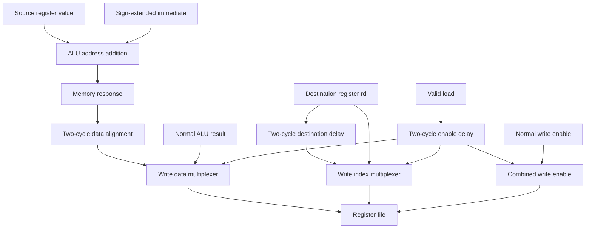
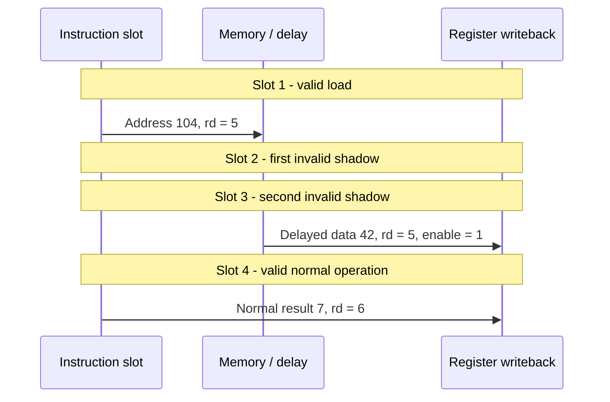

# 61 – RV_D5SK3_L2 – Load Data from Memory to Register File

## Objective

Extend the load pipeline introduced in [Lecture 60](60_Load_Store_Instructions.md) to synchronize returned memory data with the destination register and writeback control.

## 1. Effective address generation

The ALU is reused for memory addressing: effective address = rs1 + sign-extended immediate. Both load and store instructions use this calculation.

## 2. Delayed load writeback

An ordinary ALU instruction can write its result directly. A load must wait for memory data. In the workshop's fixed-latency design, the destination index and valid-load indication are carried forward by two cycles along with the corresponding data.

## 3. Register-file writeback selection

The independent demonstration uses separate normal and delayed-load write enables. This avoids confusing the combined register-file enable with the selector for ALU data.

```verilog
$load_wr_en = !$reset && >>2$valid_load && (>>2$rd != 5'd0);
$rf_wr_en = $normal_wr_en || $load_wr_en;
$rf_wr_index[4:0] = $load_wr_en ? >>2$rd : $rd;
$rf_wr_data[31:0] = $load_wr_en ? >>2$ld_data : 32'd7;
```

The constant 7 represents an illustrative normal ALU result in this standalone test. A complete processor would select its actual ALU result. The load write must be permitted even when the current instruction slot is invalid.

## 4. Timing and load shadow

| Slot | Operation | Current instruction valid | Register write |
|---|---|---|---|
| 1 | Load from address 104 | Yes | None |
| 2 | First shadow | No | None |
| 3 | Second shadow | No | x5 = 42 (delayed load) |
| 4 | Normal operation | Yes | x6 = 7 |

The two shadow slots reserve time for memory return and prevent a competing ordinary write. The full processor must also redirect the PC and replay the invalidated instructions, as discussed in Lecture 60.

## 5. Makerchip implementation

[Open the independent TL-Verilog source](../src/lec61_load_writeback.tlv)

The demonstration models a fixed memory word at byte address 104 and two registers, x5 and x6. It checks that the delayed load writes 42 into x5, a later normal operation writes 7 into x6, and no writeback collision occurs.


### Conceptual datapath



This is an explanatory datapath, not a Makerchip-generated screenshot.

### Expected timing waveform



The following transaction-aligned timing table represents the expected waveform of the standalone demonstration. Values are illustrative, not measured.

| Signal | Slot 0 | Slot 1 | Slot 2 | Slot 3 | Slot 4 | Slot 5 |
|---|---:|---:|---:|---:|---:|---:|
| valid | 1 | 1 | 0 | 0 | 1 | 1 |
| valid_load | 0 | 1 | 0 | 0 | 0 | 0 |
| load_wr_en | 0 | 0 | 0 | 1 | 0 | 0 |
| normal_wr_en | 0 | 0 | 0 | 0 | 1 | 0 |
| rf_wr_en | 0 | 0 | 0 | 1 | 1 | 0 |
| rf_wr_index (when enabled) | — | — | — | 5 | 6 | — |
| rf_wr_data (when enabled) | — | — | — | 42 | 7 | — |
| x5 (updated value) | 0 | 0 | 0 | 42 | 42 | 42 |
| x6 (updated value) | 0 | 0 | 0 | 0 | 7 | 7 |

Slot 0 assumes reset has been released. Actual clock-edge presentation depends on the simulator's signal alignment.

## 6. Expected verification

| Signal | Expected value |
|---|---|
| Effective address | 0x00000068 |
| Returned data | 0x0000002A |
| Delayed destination | 5 |
| Final x5 | 42 |
| Final x6 | 7 |
| Collision | 0 |

Makerchip compilation and simulation are pending. These are expected results, not captured measurements.

Capture the waveform showing slot, valid_load, load_wr_en, rf_wr_index, rf_wr_data, x5 and x6; also save the generated datapath and simulation log.

## 7. Scope and limitations

This standalone exercise uses scheduled shadow slots, a constant memory response and two modeled registers. It does not implement a full register file, actual data memory, stores, variable memory latency or PC replay. Integration with the complete processor remains pending.

## Learning outcomes

- Effective address calculation and ALU reuse.
- Delayed destination and control propagation.
- Memory-return synchronization.
- Register writeback multiplexing.
- Load shadow timing and collision prevention.

## References

- VSD RISC-V MYTH Workshop
- [Makerchip IDE](https://makerchip.com/)
- [Workshop resources](https://github.com/stevehoover/RISC-V_MYTH_Workshop)
