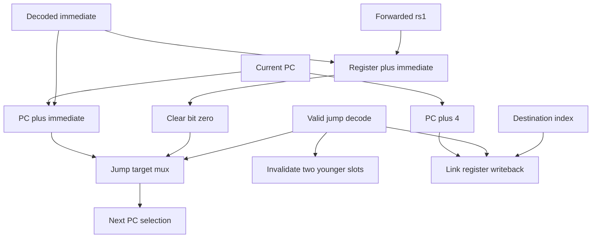

# 64 – RV_D5SK3_L5 – Control Logic for Jump Instructions

## Objective

Extend the control-flow logic to handle JAL and JALR, including target calculation, link values, PC redirection and invalidation of younger instructions.

## 1. Jump operations

| Instruction | Target | Link value |
|---|---|---|
| JAL | PC + sign-extended J immediate | PC + 4 |
| JALR | (rs1 + sign-extended I immediate) & 0xFFFFFFFE | PC + 4 |

JALR uses the source operand after forwarding in a complete pipeline. Clearing bit zero is an RV32I requirement added to the supplied lecture description. Instruction-address alignment exceptions are outside this demonstration.

## 2. Decode and target calculation

JAL uses opcode 0x6F. JALR uses opcode 0x67 and funct3 = 0. Both are unconditional, but only valid instructions may initiate redirection. The link write is suppressed when rd is x0.

## 3. Jump shadows

The workshop uses two invalid younger instruction slots following a redirect. Validity must gate the redirect itself and architectural writes. A full CPU must arbitrate branch, load replay and jump redirection together; this exercise isolates jumps.

## 4. Conceptual datapath

This is a conceptual diagram, not a captured Makerchip datapath.

## 5. Makerchip implementation

[Independent TL-Verilog source](../src/lec64_jump_control.tlv)

The test program uses JAL x5,16 at PC 4 and JALR x6,1(x1) at PC 20, with a modeled x1 value of 32. The JALR sum is 33 and clearing bit zero gives target 32.

## 6. Expected waveform

| Transaction | PC (decimal) | Valid | Operation |
|---|---:|---:|---|
| 1 | 0 | 1 | NOP |
| 2 | 4 | 1 | JAL; link x5 = 8 |
| 3 | 8 | 0 | Shadow |
| 4 | 12 | 0 | Shadow |
| 5 | 20 | 1 | JALR; link x6 = 24 |
| 6 | 24 | 0 | Shadow |
| 7 | 28 | 0 | Shadow |
| 8 | 32 | 1 | Redirect target reached |

Expected final values: x5 = 8, x6 = 24, jump count = 2, shadow count = 4. The testbench checks these values at the final target.

## 7. Verification and scope

Makerchip generated the supplied waveform and datapath successfully. The waveform shows JAL target 0x14, JALR sum 0x21, aligned JALR target 0x20, two valid jumps, shadow signals and link write enables. The final PASS log and final register values are not visible in the supplied screenshots. The timing table remains an expected sequence. This standalone test uses a small instruction ROM, a constant source operand and two modeled destination registers. It does not integrate the complete CPU, branch/load arbitration, forwarding or exception handling. Actual screenshots have been captured; repository image upload is pending.

## Learning outcomes

- Distinguish PC-relative and register-relative jumps.
- Calculate target and return addresses.
- Gate redirects and register writes with validity.
- Invalidate younger instructions after a jump.

## References

- VSD RISC-V MYTH Workshop
- [Makerchip IDE](https://makerchip.com/)
- [Workshop resources](https://github.com/stevehoover/RISC-V_MYTH_Workshop)
